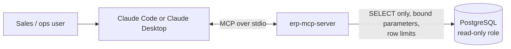

# erp-mcp-server

**Ask Claude about your orders, production and stock, without giving it the keys to the database.**

An [MCP](https://modelcontextprotocol.io) server that connects Claude (Claude Code,
Claude Desktop or the API) to a manufacturing ERP database. It exposes a small set
of read-only, parameterised tools, so a sales or operations person can ask:

> *"Which open orders for Coastal Bakeries are due this week, and do we have the stock?"*

and Claude answers from live data by calling `find_customers`, then `open_orders`, then `stock_position`.



## Tools

| Tool | Answers |
|---|---|
| `find_customers(text)` | Which account is "Coastal"? |
| `get_order(order_number)` | What's on SO-24003 and what is it worth? |
| `trace_order(order_number)` | Where is this order? PO → sales order → batches → dispatch → proof of delivery, plus any production shortfall |
| `stock_position(sku)` | How much do we have per location, and how much is already promised to open orders? |
| `open_orders(customer_code?, due_before?)` | What's still open, soonest due first? |

Plus a resource, `erp://schema`, describing how the tables relate.

## Safety by design

The caller is a language model, so its input is treated as untrusted:

- **Fixed queries, no raw SQL tool.** Every tool is a parameterised SQLAlchemy
  query. LIKE wildcards are escaped. Lists are capped at 50 rows.
- **Read-only twice.** Tools are annotated `readOnlyHint`, and the database role
  ([`sql/readonly_role.sql`](sql/readonly_role.sql)) has `SELECT` only,
  `default_transaction_read_only` and a 5-second statement timeout. CI proves the
  role cannot write.
- **Errors the model can use.** Not-found returns `{"error": "No sales order SO-404"}` instead of a stack trace.
- **Credentials stay outside the repo.** `.mcp.json` reads the connection string
  from the `ERP_DATABASE_URL` environment variable.

## Run it

```bash
python -m venv .venv && source .venv/bin/activate    # Windows: .venv\Scripts\activate
pip install -e ".[dev]"
python -m erp_mcp.seed        # fictional demo data in erp_demo.db
python -m pytest -q
```

**In Claude Code:** open the folder and run `claude`. The project's
[`.mcp.json`](.mcp.json) registers the server; approve it when prompted, then ask
a question about the orders.

**Against PostgreSQL:**

```bash
psql "$ADMIN_URL" -f sql/schema.sql
psql "$ADMIN_URL" -f sql/readonly_role.sql
export ERP_DATABASE_URL="postgresql+psycopg://erp_mcp_readonly:<password>@host:5432/erp"
```

## Built with Claude Code

- [`CLAUDE.md`](CLAUDE.md): the rules for this codebase (read-only, no raw SQL tool, Decimal money).
- [`.claude/commands/add-tool.md`](.claude/commands/add-tool.md): `/add-tool` slash command, the checklist for adding a tool.
- [`.claude/agents/sql-reviewer.md`](.claude/agents/sql-reviewer.md): a read-only subagent that reviews query and schema changes for injection, writes, unbounded results and schema drift.

## Tests and CI

Tests run against SQLite locally and against a real PostgreSQL 17 service in
GitHub Actions, which also applies the hand-written `schema.sql` and checks
that the read-only role is refused when it tries to write.

All customer, order and stock data in this repository is fictional.

## Licence

MIT
